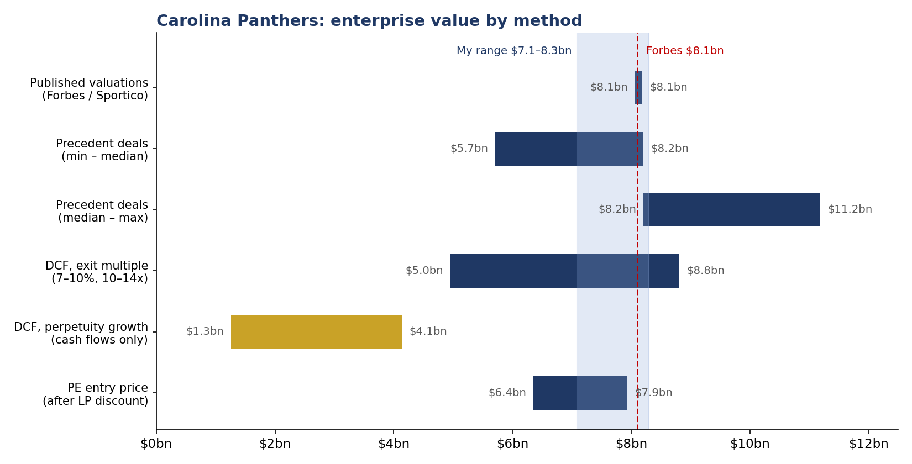

# Carolina Panthers Valuation & Private-Equity Stake Analysis

**Vincent Huang** · UNC Charlotte, BSBA Finance (AI minor), Class of 2029 · October 2026

Since 2024 the NFL has allowed approved private-equity firms to own 3–10% of a team, with a six-year minimum hold and no control. Forbes values the Carolina Panthers at **$8.1 billion**. This project asks one question: **if a PE firm could buy 10% of the Panthers at that price, should it?**

## Answer

**Pass at the headline price; buy at a 30%+ minority discount or on a strong 2029 media-rights outcome.**

| | Result |
|---|---|
| DCF, cash flows only (perpetuity growth) | **~$2.2B** |
| DCF, exit multiple (12x revenue) | ~$7.0B |
| Precedent-transaction median (12.7x) | ~$8.2B |
| Market (Forbes / Sportico) | $8.1B |
| 10% stake, base-case IRR (20% LP discount, 6-yr hold) | **12.5%** vs. 15% hurdle |
| Appreciation needed to clear 15% | 12.8% / yr |
| Entry discount needed at 10%/yr appreciation | 30% |

The market pays **3.7x** what the cash flows support. Since 2017 the team's value compounded 17% a year while revenue grew 6%; the revenue multiple went from 5.8x to 12.5x. A minority stake is an appreciation bet, not a yield bet: distributions add less than one point of IRR.



## What's in the repo

```
panthers_valuation/
  inputs.py      every assumption, with its source, in one dataclass
  dcf.py         10-year projection, two terminal methods, sensitivity grids
  comps.py       nine NFL transactions (2022–2026) and implied values
  pe_stake.py    bear/base/bull IRR for a 3–10% stake; break-even growth and discount
  charts.py      football field, history, IRR bars, sensitivity heatmaps
data/
  nfl_transactions.csv    deal, stake, implied value, trailing revenue (Forbes team pages), source note
  panthers_history.csv    Forbes 2017–2025: value, revenue, operating income, player costs
tests/test_model.py       checks the Python model reproduces the Excel model to the dollar
run_valuation.py          one command: prints the results, writes charts and CSVs to output/
Panthers_Valuation.ipynb  the walkthrough, with the recommendation
```

## Run it

```bash
pip install -r requirements.txt
python run_valuation.py          # results + charts in output/
python -m pytest tests           # 6 tests, all should pass
jupyter notebook Panthers_Valuation.ipynb
```

Change any assumption by passing it to `Inputs`:

```python
from panthers_valuation import Inputs, dcf_value
dcf_value(Inputs(media_uplift_2030=0.0, discount_rate=0.10))   # DCF bear case
```

## Method

**DCF.** National (shared league) revenue is ~70% of the total and grows with the media deals (6%/yr to 2029, an assumed 10% step-up after the 2029 opt-out, 5% after). Local revenue grows 3% with a 20% lift when the renovated Bank of America Stadium opens in 2028 ($650M city funding + $150M from Tepper Sports, approved June 2024). Player costs track the salary cap. Owner cash flow is after a 25% tax approximation, maintenance capex and the team's stadium contributions. Discounted at 8% (range 7–10%); terminal value by 12x revenue and by 4% perpetual growth.

**Comps.** Nine control and minority sales from the Broncos (2022, 8.8x) to the Seahawks (2026, 14.6x). Trailing revenue is the season before each deal, from each team's Forbes page. Minority and PE deals have printed above control deals, which says a lot about PE demand.

**PE stake.** Entry at 10% of equity after a 20% LP discount; exit after six years with the discount narrowing to 10%; half of free cash flow distributed during the hold.

## Key risks
Media rights disappoint at the 2029 opt-out · multiple compression if PE demand cools · no control and no guaranteed exit · on-field results (2025 playoff run followed seven losing seasons) · owner concentration.

## Sources
Forbes NFL Team Valuations 2026 and Forbes team pages (Panthers, Seahawks, Broncos, Commanders, Giants, Falcons, Browns, Raiders, Dolphins, Bills) · Sportico (2025 national revenue per team; NFL private-equity rules and deals) · CNBC (Giants minority sale, Oct 2025) · WFAE (Charlotte stadium funding vote, June 2024) · Charlotte Business Journal via Yahoo Sports.

*All team-level financials are Forbes estimates. NFL teams do not publish financial statements.*
